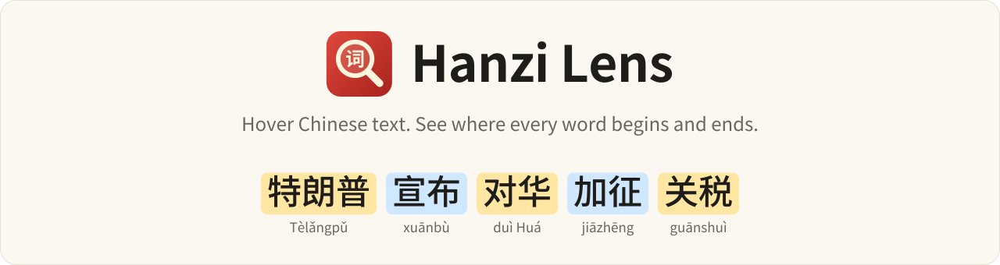
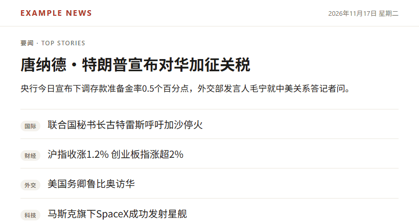
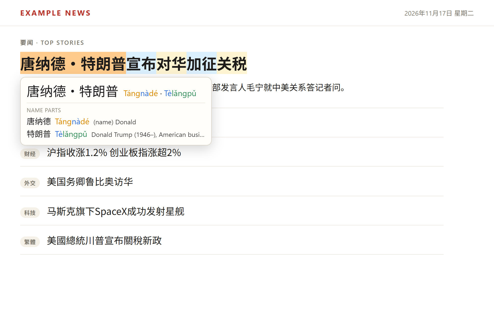
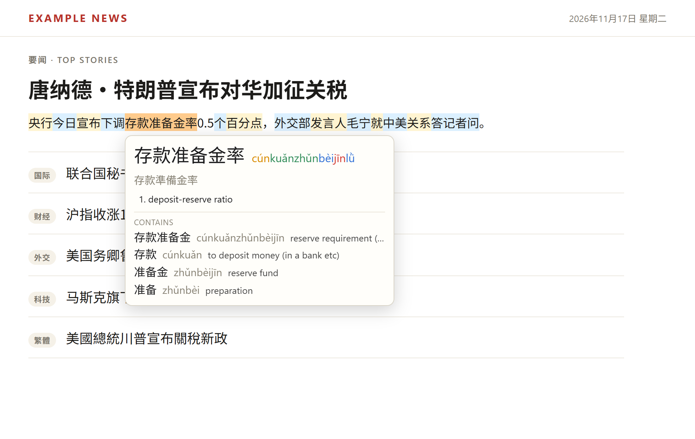
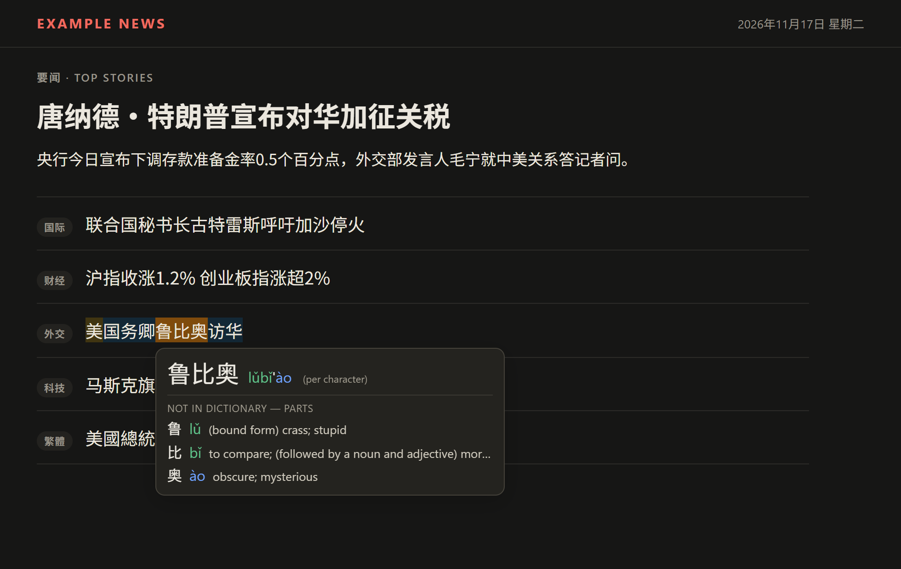
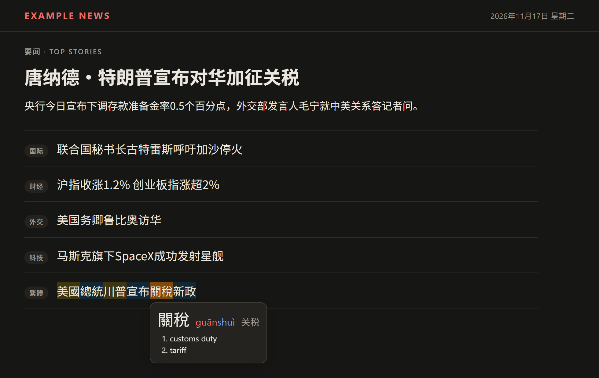
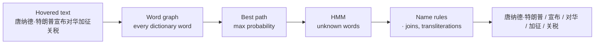

<p align="center">
  <picture>
    <source media="(prefers-color-scheme: dark)" srcset="assets/banner-dark.svg">
    
  </picture>
</p>

<p align="center">
  <a href="https://github.com/Dri-water/hanzi-lens/releases/latest"></a>
  <a href="https://github.com/Dri-water/hanzi-lens/actions/workflows/ci.yml"></a>
  <a href="LICENSE"></a>
  
  
</p>

<p align="center">
  <a href="#install">Install</a> ·
  <a href="#features">Features</a> ·
  <a href="#how-it-works">How it works</a> ·
  <a href="#development">Development</a> ·
  <a href="#roadmap">Roadmap</a>
</p>

---

Chinese is written without spaces, so the hardest part of reading it is often working out **which characters belong together**. Some lookup tools only match the longest word starting at the cursor. Hanzi Lens segments the **whole sentence** and tints every word, so the boundaries are visible at a glance. Hover any word for its **pinyin** and **English definitions**.

<p align="center">
  
</p>

## Features

<table>
  <tr>
    <td width="50%" valign="top">
      
      <p><b>Names stay whole.</b> Dot-joined names like 唐纳德·特朗普 become one unit, with a lookup for each part. These are the hardest things to split by eye.</p>
    </td>
    <td width="50%" valign="top">
      
      <p><b>See inside long words.</b> 存款准备金率 shows its definition and the words it's built from. The whole sentence is tinted word by word.</p>
    </td>
  </tr>
  <tr>
    <td width="50%" valign="top">
      
      <p><b>Handles words no dictionary has.</b> New transliterations like 鲁比奥 (Rubio) are kept together and broken into their characters.</p>
    </td>
    <td width="50%" valign="top">
      
      <p><b>Simplified and traditional.</b> 關稅 and 关税 both work, each shown with its other form. Light and dark themes follow your system.</p>
    </td>
  </tr>
</table>

- **Pinyin per word, not per character.** Polyphones come out right: 银行 *yínháng* · 行走 *xíngzǒu* · 长大 *zhǎngdà*. Tones are colour-coded.
- **Built for news.** Tested against headlines full of abbreviations (国台办, 美联储, 沪指收涨) and names.
- **Works across markup.** Headlines split across `<a>`, `<b>` and `<em>` tags are segmented as one sentence.
- **Private and offline.** The dictionary ships with the extension: no network requests, no accounts, no analytics.

## Install

### From a release (recommended)

1. Download **`hanzi-lens-extension-*.zip`** from the [latest release](https://github.com/Dri-water/hanzi-lens/releases/latest) and unzip it somewhere permanent.
2. **Chrome / Edge:** open `chrome://extensions` (or `edge://extensions`), turn on **Developer mode**, click **Load unpacked**, and choose the unzipped folder.
3. **Firefox:** open `about:debugging#/runtime/this-firefox`, choose **Load Temporary Add-on**, and pick `manifest.json`.

Store listings (Chrome Web Store, Firefox Add-ons) are on the [roadmap](#roadmap).

### Usage

| Action | How |
| --- | --- |
| Look up a word | Hover over it |
| Turn on or off | Click the toolbar icon, or <kbd>Alt</kbd>+<kbd>Shift</kbd>+<kbd>Z</kbd> |
| Close the popup | <kbd>Esc</kbd>, or move the pointer away |

## How it works



1. **Lexicon.** About 427k words with frequencies (from jieba) plus about 125k CC-CEDICT entries. jieba's phrase-like compounds that split cleanly into dictionary words are pruned (中美关系 → 中美 + 关系), so the boundaries stay useful for learners.
2. **Segmentation.** Every dictionary word in the sentence goes into a graph, and the highest-probability path wins. Leftover single characters go to a hidden Markov model (jieba's model), which recovers words it has never seen.
3. **Names.** Runs of transliteration characters (斯, 基, 克, 尔 …) are kept together, and dot-joined names are merged.
4. **Lookup.** Common readings are ranked first (宁 *níng* before the rare *zhù*), and "see X" cross-references are followed.

The engine in [`packages/core`](packages/core) has no browser dependencies. The extension is a thin front end, so a future desktop app can reuse the same core.

## Development

```bash
git clone https://github.com/Dri-water/hanzi-lens.git && cd hanzi-lens
npm install
npm run data      # downloads CC-CEDICT + jieba → packages/core/data/lexicon.json
npm run build     # → packages/extension/dist (load unpacked)
npm test          # headline + unit tests
```

```bash
npm run seg -- --lookup "美国务卿鲁比奥访华"
# 美 / 国务卿 / 鲁比奥 / 访华
#   国务卿  guówùqīng  Secretary of State
#   鲁比奥  lǔbǐ'ào (~)  (no entry)
#   ...
```

To try the UI without installing, serve `packages/extension/dist` and open `/demo.html` or `/showcase.html`.

<details>
<summary><b>Project layout</b></summary>

```
packages/
  core/          UI-agnostic engine
    src/           segmenter · hmm · lexicon · lookup · pinyin
    scripts/       build-data.mjs (dictionary pipeline) · seg.ts (CLI)
    data/          supplement.u8 (our additions, CEDICT format)
    test/          headlines.ts (news test cases) · core.test.ts
  extension/     Manifest V3 extension
    src/           background (owns the dictionary) · content (hover) · popup
    dev/           demo + showcase pages (run without installing)
assets/          logo, banners, screenshots
tools/           brand/ (logo + icon generation) · screenshots.mjs
```
</details>

<details>
<summary><b>Regenerating the logo and screenshots</b></summary>

```bash
python tools/brand/build_brand.py     # logo + banners (outlined Noto Sans SC)
node tools/brand/render-icons.mjs     # extension icons from the logo
npm run build && node tools/screenshots.mjs   # screenshots + demo.gif (needs Chrome, ffmpeg)
```
</details>

### Contributing

News headlines make a good stress test. If you find one that segments badly, [open an issue](https://github.com/Dri-water/hanzi-lens/issues/new?template=bad-segmentation.yml). Or fix it yourself:

1. Add the headline and its expected split to [`packages/core/test/headlines.ts`](packages/core/test/headlines.ts).
2. Usually the fix is a new term in [`packages/core/data/supplement.u8`](packages/core/data/supplement.u8). Then run `npm run data`.
3. Run `npm test` and open a PR.

## Roadmap

- [x] Sentence-level segmentation, pinyin, CC-CEDICT definitions
- [x] Name handling (dot-joined and unseen transliterations)
- [ ] Chrome Web Store and Firefox Add-ons listings
- [ ] Settings: tint style, popup trigger key, script preference
- [ ] Better readings for single characters in context (了, 着, 长)
- [ ] **Desktop app** (Windows first): hotkey lookup on selected text, then hover via UI Automation, with OCR fallback for images and video subtitles

## License

Code is [MIT](LICENSE). Dictionary data comes from [CC-CEDICT](https://www.mdbg.net/chinese/dictionary?page=cc-cedict) (CC BY-SA 4.0) and [jieba](https://github.com/fxsjy/jieba) (MIT). Both are downloaded at build time, and the bundled `lexicon.json` is CC BY-SA 4.0. The logo uses outlines from [Noto Sans SC](https://fonts.google.com/noto/specimen/Noto+Sans+SC) (SIL OFL).
